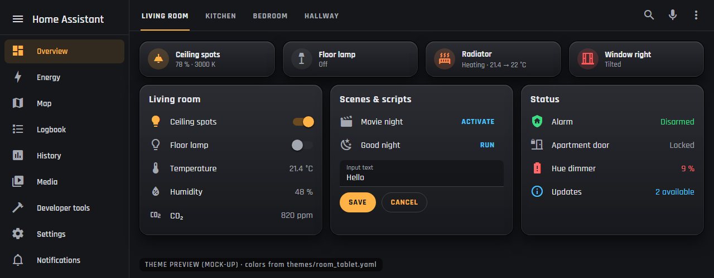
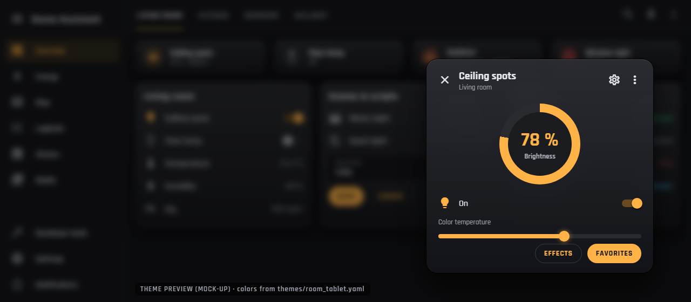

# Room Tablet Theme



*Theme preview (mock-up): a static page using the colors from `themes/room_tablet.yaml`, not a real Home Assistant screenshot.*

<details><summary>More screenshots</summary>

**More-info dialog (mock-up)**



</details>

A dark metal/glass theme for Home Assistant that matches the
[room_panel_ha_card](https://github.com/SysriX/room_panel_ha_card) and
[room_tablet_ha_card](https://github.com/SysriX/room_tablet_ha_card) wall-tablet dashboards. It styles the
more-info dialog, menus, settings pages and the standard HA cards: dark surfaces, glass-like cards and dialogs
with blur, orange primary / cyan accent colors and the Rajdhani font.

- Theme name: `Room Tablet`
- File: `themes/room_tablet.yaml`

> Built for the author's own wall tablets.
> **Note for existing users:** the theme key was renamed from `Raum Tablet` to `Room Tablet`. If you selected the
> old name (user profile or `frontend.set_theme`), select `Room Tablet` again.

## Features

- All colors are defined under `modes: dark:` only, so Home Assistant always uses dark mode with this theme
  (avoids dark text on dark backgrounds with newer HA color variables).
- Text contrast ≥ 4.5:1 on all surfaces.
- Glass dialogs and bottom sheets (`backdrop-filter` blur), metal-look cards with subtle inner highlight.
- LED-style state colors (lights, heating, cooling, binary sensors).

## Requirements

- Home Assistant 2024.1 or newer.
- The font Rajdhani is loaded by the room panel / room tablet cards. Without them the theme falls back to
  Segoe UI / Roboto.

## Installation

### HACS (custom repository)

1. HACS → ⋮ → **Custom repositories** → add `https://github.com/SysriX/room_tablet_ha_theme`, category **Theme**.
2. Install **Room Tablet Theme**.
3. Make sure themes are loaded in `configuration.yaml`:
   ```yaml
   frontend:
     themes: !include_dir_merge_named themes
   ```
4. Restart Home Assistant (or call `frontend.reload_themes`) and select **Room Tablet** in your user profile.

### Manual

Copy `themes/room_tablet.yaml` to `/config/themes/` and continue with steps 3–4 above.

### Set as default for all users/devices

```yaml
action: frontend.set_theme
data:
  name: Room Tablet
  mode: dark
```

## License

MIT License, see [LICENSE](LICENSE).
